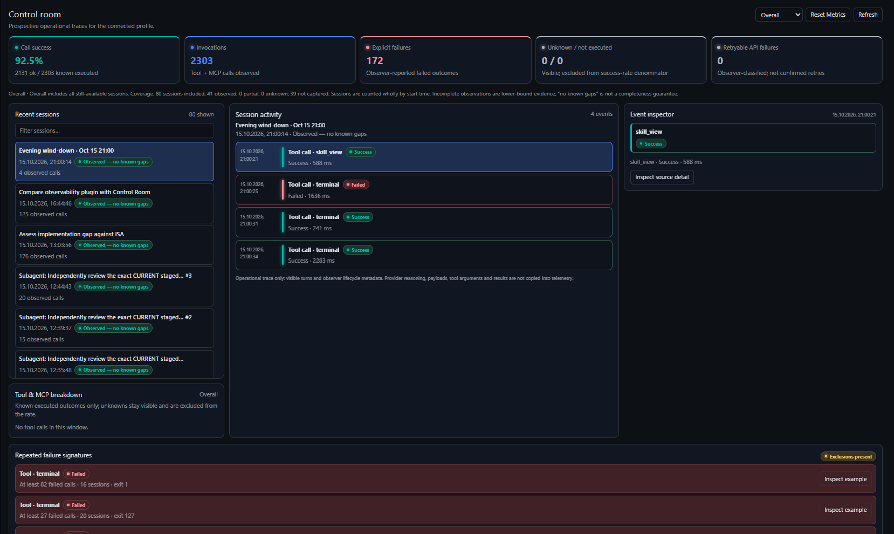

# hermes-observability-plugin

A native Hermes Desktop observability plugin. The consolidated specification is in [`docs/ISA.md`](docs/ISA.md); the Control room reference is [`docs/prototype/session-overview.html`](docs/prototype/session-overview.html).

## Control room



## MVP scope

This first implementation slice is deliberately narrower than the ISA first release. It proves the end-to-end capture and inspection path without widening the approved boundary:

- Capture is prospective and local to the connected profile. Only sessions observed starting after the plugin is enabled are eligible; already-open sessions are skipped.
- The native Desktop Control room lists sessions within an Overall, Today, or Since Reset window, labels uncaptured/partial/observed coverage, shows filtered tool-call counts and success rates, and drills into tool/MCP observer events.
- Repeated-failure findings group explicit failed logical tool calls across at least two sessions by exact observer tool identity and a structured error code/type, or an exact error message after masking UUIDs and ISO timestamps only. MCP's observer name is the canonical combined `mcp__server__tool` identity; server/tool names remain part of the match key. No fuzzy matching or generated remediation is used.
- Findings show the match basis, distinct calls, affected sessions, first/last observation, observed timeout count, a short error excerpt, and example-call links into source-backed call detail. When the selected population includes excluded coverage, findings are labeled “at least N observed.” Provider retry counts are shown as unavailable until API-attempt capture is implemented; provider retries never inflate tool invocation counts.
- Today uses the Desktop user's local calendar timezone. Sessions are included or excluded as a whole by their start timestamp, including sessions that continue across a day or reset boundary.
- Reset Metrics advances the plugin-owned Since Reset cutoff and never deletes or mutates source sessions or telemetry rows. Repeating reset replaces the cutoff; Overall remains unchanged.
- Each window reports included sessions and coverage/rate exclusions. Unknown and not-executed outcomes remain visible and are excluded from the success-rate denominator. Rates use only schema-compatible, gap-free sessions; observed counts from incomplete populations are lower-bound evidence.
- Call detail reads visible arguments/result and nearby visible conversation from canonical session messages on demand using exact session/tool-call IDs, alongside captured error metadata; it never copies source content into plugin telemetry, and missing or ambiguous matches remain unavailable.
- Store versioned, plugin-owned metadata tables in the connected profile's existing `state.db`; source-session deletion cascades to plugin rows.
- Persist only observer identity/correlation fields, timestamps, tool name, explicit outcome, duration, and structured error details. Do not copy tool arguments/results, provider request/response payloads, reasoning, or child transcripts.

Not yet implemented in this slice: provider retry records, approval/subagent event families, and the user-triggered Analyze flow. These remain bounded by the ISA and are later implementation slices, not rejected features. Export, cross-install aggregation, automatic analysis, and unattended remediation remain out of scope as specified by the ISA.

“Observed — no known gaps” is not a completeness guarantee: Hermes observer hooks fail open. This plugin is explicitly enabled through Hermes' plugin trust gates; once enabled, collection starts prospectively by default. No performance target is claimed before benchmarking.

## Installation

The plugin has two parts: an agent/backend half that runs with the gateway profile, and a Desktop UI half that runs in the Hermes Desktop app. When Desktop connects to a remote gateway, install the halves on their respective machines.

### Install and enable the gateway half

Run this on the gateway host, using the Hermes profile whose sessions you want to observe:

```sh
hermes plugins install --enable https://github.com/cyferlawyn/hermes-observability-plugin.git
```

The `--enable` flag enables the agent/backend half in that profile. Verify its status with:

```sh
hermes plugins list --plain --no-bundled
```

### Install and enable the Desktop UI

In Hermes Desktop on the client machine, open **Settings → Capabilities → Plugins → Install from Git** and enter the same repository URL. For a remote gateway where the agent half is already installed, choose **Desktop only** (leave the agent/backend half unchecked). After installation, enable the **Observability** Desktop plugin. It adds an **Observability** item to the sidebar.

If both the gateway and Desktop app use the same local Hermes home, the installer can install both halves together instead.

### Verify capture

Start a new Hermes session after enabling the gateway half, then make a tool/MCP call. The Control room should list that session and its observed call. Capture is prospective: sessions that were already open or started before enablement are not backfilled. Only operational metadata is stored; tool arguments and results are not captured.

## Development

Run the storage and collector tests with:

```sh
python3 -m unittest discover -s tests -v
```

The package layout follows Hermes' unified-plugin convention: `plugin.yaml` and `__init__.py` for the observer hooks, `dashboard/` for the profile-routed backend, and `desktop/plugin.js` for the local UI.
